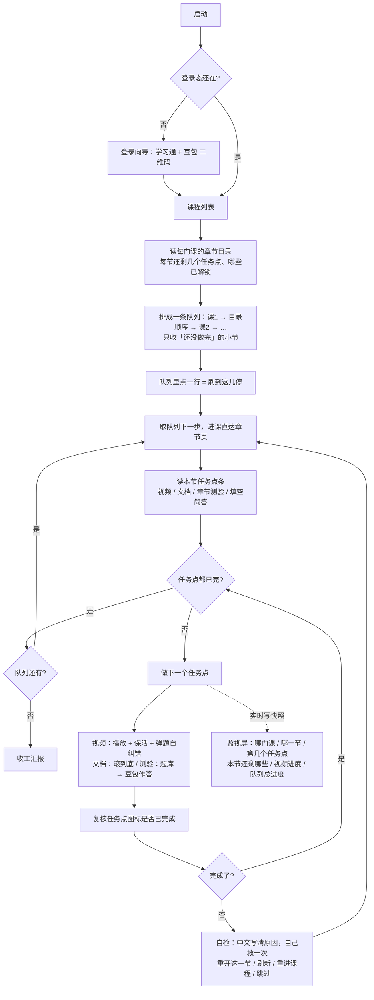

# 玄眼奇工（学习通自动挂机刷课答题工具）

> 一个跑在桌面上的网课代办小工具：用自己的账号打开学习通，选几门课（可多选、按点的顺序排队），点一行当终点，剩下的交给一条队列 —— 按目录顺序把**视频任务点**看到达标（一个任务点里挂几段就播几段）、把**文档任务点**（Word / PDF / PPT）滚到完成、把**章节测验**和**期中期末试卷**答完并提交，填空 / 简答 / 计算这类没有选项的题交给 AI 写文字答案。主窗口右栏嵌着一块深色**监视屏**，实时显示它在刷哪一节、卡在哪、准备怎么救。
>
> **这个仓库只公开它怎么做到的**：架构、原理、用到的工具、当前版本的局限，以及少量可以独立阅读的代码片段。**不提供**可直接运行的完整源码、打包好的 exe、任何登录态或题库数据。

当前公开版本：**v3.2.0**（[更新日志](CHANGELOG.md) · [版本索引](docs/versions/README.md)）


---

## 一、它能做什么

| 能力 | 说明 |
| --- | --- |
| 自动登录 | 首次运行弹「登录向导」：学习通二维码（自动勾「下次自动登录」）/ 账号密码小窗 + 豆包（抖音扫码）二维码，都嵌在脚本窗口里 |
| 多课顺序队列 | 课程列表里点几门课（按点击顺序排队）→ 一次抓完 → 把每门课「还没做完的小节」按目录顺序串成一条队列：课1 → 课1 的目录顺序 → 课2 → … |
| 任务点级目录状态 | 从章节目录直接读每一节「还剩几个任务点」（`knowledgeJobCount` / 徽章数字），锁着的小节标「锁定 · 可预约」；读不到的当成「至少还有 1 个」，不把还剩一半的节当做完 |
| 进课直达章节 | 新版泛雅点开课先落在「课程首页」，脚本把「点『章节』tab」和「等章节树渲染」合成一个轮询：tab 一露头就点，树一出来立刻读，不再死等 30 秒 |
| 看视频 | 打开小节 → 找到 video → 播放 → 保活（防「离开页面暂停」）→ 弹窗提问自动作答；**一个任务点里挂了几段视频就接着播几段**（换段靠「src + 时长」签名认，播完等 2 秒再看有没有下一段） |
| 判定视频达标 | 以学习通自己的任务点图标（ans-job-finished）为准；播到 91% 先问一次，没算完成就播到 96% 再问，仍没完成才播到尾 |
| 章节测验 | 解析题干与选项 → 还原字体加密 → 逐题取答案 → 逐题勾选 → **自检「每题都选上了吗」** → 提交 → 读分 → 不到 80 分找「重做」入口 |
| 读文档任务点 | Word / PDF / PPT / 资料类任务点：把每一层能滚的容器滚到底、点「下一页 / 继续」，直到任务点图标变成已完成 |
| 讨论任务点 | 进话题读老师给的材料 → 让 AI 写一段 120~200 字学生口吻的回复 → 填进回复框（派发 input/change/keyup）→ 点「回复 / 发表」提交 → 提完再复核完成状态；AI 不可用时默认不发，留给你手动回 |
| 完成度实时复核 | 判定的是「**这一个任务点**做完没有」，不是「本节还剩几个」：页面三路信号（容器 `ans-job-finished` / 图标 aria / 绿字「任务点已完成」）→ 服务器未完成数的基线对比（做完一个少一个就算过）→ 本节归零。播放循环每 3 秒自查一次，页面亮了完成立刻停播 |
| 读页面源码认任务点 | 整页 HTML（F12 里那份）用标准库解析成轻量 DOM，任务点标签条、内容容器、任务点总数、未完成数、空目录提示、考试入口都从同一份源码读，不靠一堆积木式选择器猜 |
| 期中 / 期末试卷 | 纯考试类任务点（期中、期末、结课、单元测试）单独一条路：点开始考试 → 勾同意须知 → 整卷作答 → 交卷 → 读分；考试另开标签页的会跟过去再切回来 |
| 数学题 | 认出「求 / 计算 / 极限 / 导数 / 积分 / 矩阵 / 概率」这类题，给 AI 单独的提示词（只给最终答案），把返回的 LaTeX 压成能填的纯文本（`\frac{1}{2}` → `(1)/(2)`），按空拆开逐个填 |
| 空目录直说 | 抓目录时日志点名哪门课没抓到章节；点「开始刷课」而队列是空的，弹窗直接列出这几门课并提示重新抓取 / 去学习通确认 |
| 填空 / 简答 / 计算题 | 没有选项可点，把题干交给 AI 要一段文字答案填进输入框；拿不到就留着给人工补（勾「试填不交」可先不提交） |
| 不交白卷 | 一道都没答上 / 有题没选上 / 超过一半是瞎蒙 → 宁可不交，避免留下 0 分记录 |
| 记录 | 进度条、当前小节、「上次跑到哪个任务点」、刷课记录（优秀 / 及格 / 不及格）都留在本地 |
| 目录实时同步 | 一个任务点确认完成才转下一个；每轮重扫目录，服务端已完成的小节自动记进本地进度；页面被弹回首页会自己重新进课 |
| 只选终点 | 队列里点一行 = 刷到这儿停（不点 = 全刷）；开始前告诉你一共几个待完成任务点、终点之后还有几个不刷 |
| 视频弹题自纠错 | 弹题答错就换一组答案重答，最多 3 次；同一道题反复弹出不会无限循环（返回题目指纹） |
| 监视屏 | 深色小屏嵌在主窗口右栏（也能放大成独立窗口 / 拉全屏）：哪门课、哪一节、第几个任务点、本节还剩哪几个、视频看到几分几秒、队列总进度；配一个「查看总进度」按队列列出所有要刷的小节 |
| 自检 + 中文报错 + 自续跑 | 分得清「在思考」和「真卡死」：5 类问题（浏览器被关 / 断网 / 登录失效 / 页面改版 / 停滞）各配一个动作，自己救一次（重开这一节 / 刷新 / 重进课程 / 跳过），同一节最多自愈 2 次，救不回来才停 |
| 停止不半路扔下 | 点「停止刷课」只是置旗子：做完手上这个任务点、复核它完成没有，然后才收工 |
| 后台静默 | 浏览器窗口挪到屏幕外 + 关掉后台节流 + 焦点模拟，可以一边干别的事 |

---

## 二、它是怎么做到的（原理）



深入细节看这些文档：

- [整体架构与模块职责](docs/architecture.md)
- [关键机制逐个拆解](docs/how-it-works.md)（任务点判定、91% 提前切、弹题、测验页 DOM、字体加密、答题链与 80% 判定、禁倍速降级）
- [用到的工具与依赖](docs/tools.md)
- [当前版本的局限](docs/limitations.md)
- [路线图](docs/roadmap.md)

---

## 三、用到了哪些工具

| 层 | 用了什么 | 干什么 |
| --- | --- | --- |
| 自动化 | **Playwright**（Python sync API，channel=msedge，持久化上下文） | 打开真实 Edge 窗口、走真实页面，不伪造接口请求 |
| 界面 | **Tkinter** + **Pillow** | 主窗口、磨砂卡片皮肤、图片按钮、登录向导、三个弹窗 |
| 页面解析 | 页面内 JS 注入（page.evaluate / frame.evaluate） | 读任务点条、找 video、勾选项、自检选中状态 |
| 字体加密 | **fontTools** | 解析 @font-face 的 ttf，按 cmap 反查真实字符 |
| 答案来源 | 本地 **SQLite** 题库 + **豆包网页版**（免费） | 题库命中直接用；没命中把题干丢给豆包，按固定格式取「答案=B」 |
| 打包发布 | **PyArmor**（加密）+ **PyInstaller**（封装） | 发布版里没有明文 .py，只有加密字节码 + 运行时 |
| 安装 | 自写 Tk 安装器 + PowerShell 快捷方式 | 装到 %LOCALAPPDATA%，建桌面/开始菜单快捷方式、写卸载项 |

> 完整清单（每个库的具体用途、为什么选它、踩过的坑）见 [docs/tools.md](docs/tools.md)。

---

## 四、当前版本的局限（重要）

1. **只认学习通这一套页面**（mooc1.chaoxing.com / mooc-ans / mooc2）。页面结构一改就得跟着改选择器。
2. **课程禁止倍速时只能原速**。脚本会去试 1.25x，播放器把速度读回 1.00x 就老老实实原速播（不会去绕学校设置），一小时长视频就是一小时。
3. **闯关模式必须先解锁**。前一小节没做完，后面的进不去，只能按顺序来。
4. **分数一旦提交就改不了**。有些测验交完变「已批阅」页、没有重做入口，那一节的分就定死了（实测出现过 50 分、75 分没过的记录）。
5. **字体加密还原会错字**。font-cxsecret 只认领题面里一部分汉字（实测 20/61 ～ 25/67），还原后仍有「空问（空间）」「绘固（绘画）」这类错字，靠 AI 容错去理解。
6. **判断题靠模型知识**。豆包对个别教材口径会判错（例：「20 世纪五六十年代西方绘画开始回归写实主义」它说错），提示词改不动。
7. **浏览器窗口不能最小化**。学习通会判「离开页面」，任务点可能不计数。
8. **有风控与被封风险**。走的是真实页面、有随机停顿，但同一账号多设备 / 异常速度仍可能被识别，风险自担。
9. **只处理「视频 / 文档 / 章节测验 / 期中期末试卷 / 填空·简答·计算 / 讨论」这几类任务点**。问卷、投票、直播 / 签到不在覆盖范围（会识别并跳过）。
9.0 **讨论区发出去的话是 AI 写的**。它会读话题材料再写，但贴合度不如你自己写；介意就关掉「用豆包答题」，脚本就不会往讨论区发东西（不会拿模板话凑数）。
9.1 **连线题、拖拽题、主观论述题仍然无解** —— 这些不是「填一段文字」能解决的。
9.2 **数学题的正确率取决于模型**。AI 算错就是错，脚本不会自己验算，填空题也没有选项可蒙。
9.3 **期中期末一般只有一次机会**。脚本默认「答不齐就不交」，改 `quiz.submit_partial` 前请想清楚。
10. **监视屏只用来「看」**。它显示状态、原因和「准备怎么救」，但不能在里面点重试 / 跳过 / 换节 —— 要干预还是点主窗口的按钮。
11. **依赖 Edge**。没装 Edge 的机器要改 browser.channel。

> 更细的局限、以及哪些问题我根本不打算解决，见 [docs/limitations.md](docs/limitations.md)。

---

## 五、版本迭代（所有版本都整理在这儿）

每个版本 = 一个 commit + 一个 tag + 一个 GitHub Release，Release 正文就是该版本的更新说明。

| 版本 | 时间 | 主题 | 说明 |
| --- | --- | --- | --- |
| [v3.2.0](docs/versions/v3.2.0.md) | 2026-11-19 | 完成判定版 | 完成判定换成「这一个任务点做完没有」：服务器基线对比 + 页面三路信号，页面亮完成就停播；讨论任务点读材料写回复替你发 |
| [v3.1.0](docs/versions/v3.1.0.md) | 2026-11-19 | 读源码版 | 直接解析整页 HTML 认任务点：一个任务点多个视频、完成度实时复核、期中期末整卷、数学题、空目录课程提示；文档任务点不再空等超时 |
| [v3.0.0](docs/versions/v3.0.0.md) | 2026-11-19 | 监视屏版 | 多课顺序队列 + 只选终点 + 任务点级目录状态 + 视频弹题自纠错 + 主窗口内嵌深色监视屏 + 自检中文报错自续跑；停止改为做完当前任务点 |
| [v2.1.2](docs/versions/v2.1.2.md) | 2026-11-19 | 修复版 | 修「看完视频就收工」：任务点只看已渲染容器 → 改成标签条 ∪ 容器；点标签的 JS 没接参数；测验没读到题目不再算做完 |
| [v2.1.1](docs/versions/v2.1.1.md) | 2026-11-19 | 修复版 | 修「点开任务点就崩」的两个漏定义；顺手修两处同类未定义名 |
| [v2.1.0](docs/versions/v2.1.0.md) | 2026-11-19 | v2 重置版 | 任务点按类型做（视频 / 文档 / 测验 / 填空简答）、目录实时同步、去掉计时休息、起止范围自选、界面与 logo 重做 |
| [v1.0.0](docs/versions/v1.0.0.md) | 2026-11-18 | 首个公开版本 | 视频 + 章节测验全链路跑通；登录向导；91% 提前判定；刷课记录；加密 + 安装包 |

- 更新日志：[CHANGELOG.md](CHANGELOG.md)
- 每个版本的详细说明：[docs/versions/](docs/versions/)
- 发版流程：[docs/release.md](docs/release.md)

版本号规则：主.次.修 —— 页面适配 / 新能力涨「次」，修 bug 涨「修」，大改架构涨「主」。

---

## 六、这个仓库里有什么 / 没有什么

**有：**

```
README.md              介绍、原理、工具、局限、版本
CHANGELOG.md           全部版本的更新记录
docs/                  架构、机制、工具、局限、路线图、发版流程
docs/versions/         每个版本的说明
snippets/              少量可独立阅读的代码片段（裁剪版，非完整实现）
packaging/             加密 + 打包 + 安装的管线说明
assets/                界面截图
.github/workflows/     tag 触发 Release 的工作流
```

**没有：**

- 完整源码（只给片段与说明，跑不起来是设计如此）
- 打包好的 exe / 安装包
- 任何账号、登录态、cookie、浏览器 profile
- 题库数据、课程数据、含个人信息的截图

---

## 七、免责声明

本项目仅用于**个人学习、复习与刷课进度辅助**。请勿用于代刷、批量账号、刷分作弊或任何违反学校规定与法律法规的用途。使用本工具产生的任何后果（包括但不限于课程成绩、账号处罚）由使用者自行承担。

如果你所在课程 / 学校明确禁止自动化工具，请不要使用。

---

作者：龙潜猫隐 ｜ 版本：V 1.0.0 ｜ 交流学习用，喵～
