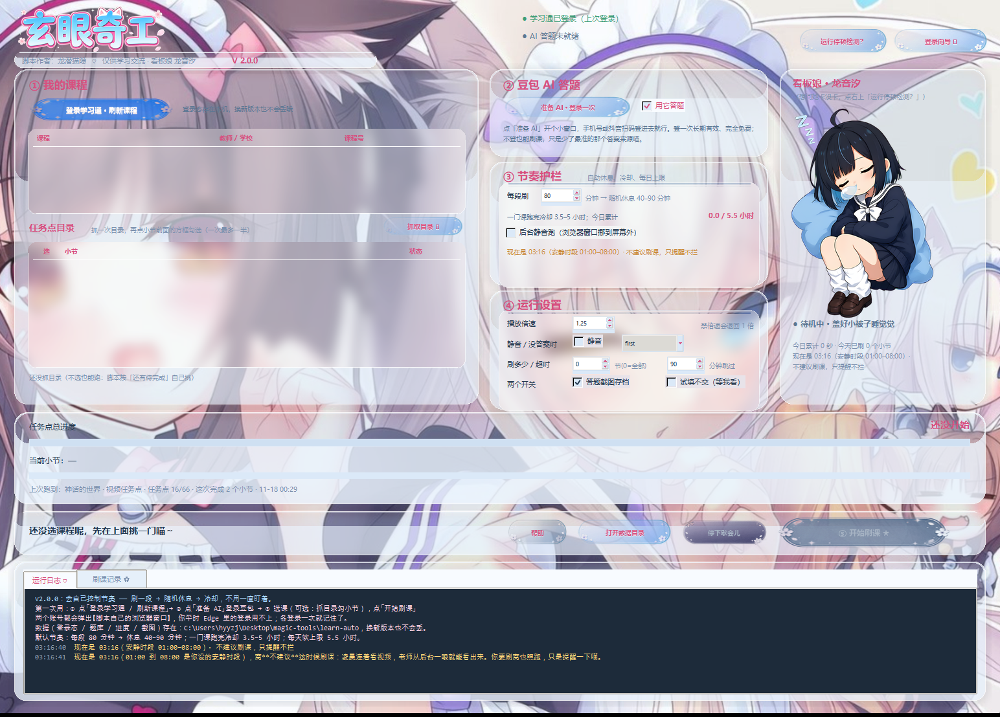
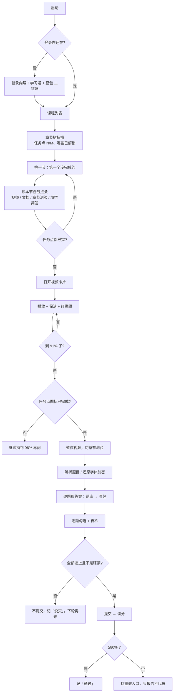

# 玄眼奇工（学习通自动挂机刷课答题工具）

> 一个跑在桌面上的网课代办小工具：用自己的账号打开学习通，按章节顺序把**视频任务点**看到达标、把**文档任务点**（Word / PDF / PPT）滚到完成、把**章节测验**答完并提交，把分数记下来。
>
> **这个仓库只公开它怎么做到的**：架构、原理、用到的工具、当前版本的局限，以及少量可以独立阅读的代码片段。**不提供**可直接运行的完整源码、打包好的 exe、任何登录态或题库数据。

当前公开版本：**v2.1.2**（[更新日志](CHANGELOG.md) · [版本索引](docs/versions/README.md)）



---

## 一、它能做什么

| 能力 | 说明 |
| --- | --- |
| 自动登录 | 首次运行弹「登录向导」：学习通二维码（自动勾「下次自动登录」）/ 账号密码小窗 + 豆包（抖音扫码）二维码，都嵌在脚本窗口里 |
| 找课、找小节 | 读课程列表 → 读章节树 → 按「任务点未完成 + 顺序」挑出该做的那一节（闯关模式下只挑已解锁的） |
| 看视频 | 打开小节 → 找到 video → 播放 → 保活（防「离开页面暂停」）→ 弹窗提问自动作答 |
| 判定视频达标 | 以学习通自己的任务点图标（ans-job-finished）为准；播到 91% 先问一次，没算完成就播到 96% 再问，仍没完成才播到尾 |
| 章节测验 | 解析题干与选项 → 还原字体加密 → 逐题取答案 → 逐题勾选 → **自检「每题都选上了吗」** → 提交 → 读分 → 不到 80 分找「重做」入口 |
| 读文档任务点 | Word / PDF / PPT / 资料类任务点：把每一层能滚的容器滚到底、点「下一页 / 继续」，直到任务点图标变成已完成 |
| 填空 / 简答 / 计算题 | 没有选项可点，把题干交给 AI 要一段文字答案填进输入框；拿不到就留着给人工补（勾「试填不交」可先不提交） |
| 不交白卷 | 一道都没答上 / 有题没选上 / 超过一半是瞎蒙 → 宁可不交，避免留下 0 分记录 |
| 记录 | 进度条、当前小节、「上次跑到哪个任务点」、刷课记录（优秀 / 及格 / 不及格）都留在本地 |
| 目录实时同步 | 一个任务点确认完成才转下一个；每轮重扫目录，服务端已完成的小节自动记进本地进度；页面被弹回首页会自己重新进课 |
| 起止范围 | 抓整门课的章节树到窗口：勾小节，或点「从这里开始 / 到这里结束」按目录顺序选一段（含两端）；已完成的小节不选，锁着的小节标「锁定 · 可预约」 |
| 后台静默 | 浏览器窗口挪到屏幕外 + 关掉后台节流 + 焦点模拟，可以一边干别的事 |

---

## 二、它是怎么做到的（原理）



深入细节看这些文档：

- [整体架构与模块职责](docs/architecture.md)
- [关键机制逐个拆解](docs/how-it-works.md)（任务点判定、91% 提前切、弹题、测验页 DOM、字体加密、答题链与 80% 判定、禁倍速降级）
- [用到的工具与依赖](docs/tools.md)
- [当前版本的局限](docs/limitations.md)
- [路线图](docs/roadmap.md)

---

## 三、用到了哪些工具

| 层 | 用了什么 | 干什么 |
| --- | --- | --- |
| 自动化 | **Playwright**（Python sync API，channel=msedge，持久化上下文） | 打开真实 Edge 窗口、走真实页面，不伪造接口请求 |
| 界面 | **Tkinter** + **Pillow** | 主窗口、磨砂卡片皮肤、图片按钮、登录向导、三个弹窗 |
| 页面解析 | 页面内 JS 注入（page.evaluate / frame.evaluate） | 读任务点条、找 video、勾选项、自检选中状态 |
| 字体加密 | **fontTools** | 解析 @font-face 的 ttf，按 cmap 反查真实字符 |
| 答案来源 | 本地 **SQLite** 题库 + **豆包网页版**（免费） | 题库命中直接用；没命中把题干丢给豆包，按固定格式取「答案=B」 |
| 打包发布 | **PyArmor**（加密）+ **PyInstaller**（封装） | 发布版里没有明文 .py，只有加密字节码 + 运行时 |
| 安装 | 自写 Tk 安装器 + PowerShell 快捷方式 | 装到 %LOCALAPPDATA%，建桌面/开始菜单快捷方式、写卸载项 |

> 完整清单（每个库的具体用途、为什么选它、踩过的坑）见 [docs/tools.md](docs/tools.md)。

---

## 四、当前版本的局限（重要）

1. **只认学习通这一套页面**（mooc1.chaoxing.com / mooc-ans / mooc2）。页面结构一改就得跟着改选择器。
2. **课程禁止倍速时只能原速**。脚本会去试 1.25x，播放器把速度读回 1.00x 就老老实实原速播（不会去绕学校设置），一小时长视频就是一小时。
3. **闯关模式必须先解锁**。前一小节没做完，后面的进不去，只能按顺序来。
4. **分数一旦提交就改不了**。有些测验交完变「已批阅」页、没有重做入口，那一节的分就定死了（实测出现过 50 分、75 分没过的记录）。
5. **字体加密还原会错字**。font-cxsecret 只认领题面里一部分汉字（实测 20/61 ～ 25/67），还原后仍有「空问（空间）」「绘固（绘画）」这类错字，靠 AI 容错去理解。
6. **判断题靠模型知识**。豆包对个别教材口径会判错（例：「20 世纪五六十年代西方绘画开始回归写实主义」它说错），提示词改不动。
7. **浏览器窗口不能最小化**。学习通会判「离开页面」，任务点可能不计数。
8. **有风控与被封风险**。走的是真实页面、有随机停顿，但同一账号多设备 / 异常速度仍可能被识别，风险自担。
9. **只处理「视频 / 文档 / 章节测验 / 填空·简答·计算」这几类任务点**。讨论、问卷、直播不在覆盖范围（会识别并跳过）。
10. **依赖 Edge**。没装 Edge 的机器要改 browser.channel。

> 更细的局限、以及哪些问题我根本不打算解决，见 [docs/limitations.md](docs/limitations.md)。

---

## 五、版本迭代（所有版本都整理在这儿）

每个版本 = 一个 commit + 一个 tag + 一个 GitHub Release，Release 正文就是该版本的更新说明。

| 版本 | 时间 | 主题 | 说明 |
| --- | --- | --- | --- |
| [v2.1.2](docs/versions/v2.1.2.md) | 2026-11-19 | 修复版 | 修「看完视频就收工」：任务点只看已渲染容器 → 改成标签条 ∪ 容器；点标签的 JS 没接参数；测验没读到题目不再算做完 |
| [v2.1.1](docs/versions/v2.1.1.md) | 2026-11-19 | 修复版 | 修「点开任务点就崩」的两个漏定义；顺手修两处同类未定义名 |
| [v2.1.0](docs/versions/v2.1.0.md) | 2026-11-19 | v2 重置版 | 任务点按类型做（视频 / 文档 / 测验 / 填空简答）、目录实时同步、去掉计时休息、起止范围自选、界面与 logo 重做 |
| [v1.0.0](docs/versions/v1.0.0.md) | 2026-11-18 | 首个公开版本 | 视频 + 章节测验全链路跑通；登录向导；91% 提前判定；刷课记录；加密 + 安装包 |

- 更新日志：[CHANGELOG.md](CHANGELOG.md)
- 每个版本的详细说明：[docs/versions/](docs/versions/)
- 发版流程：[docs/release.md](docs/release.md)

版本号规则：主.次.修 —— 页面适配 / 新能力涨「次」，修 bug 涨「修」，大改架构涨「主」。

---

## 六、这个仓库里有什么 / 没有什么

**有：**

```
README.md              介绍、原理、工具、局限、版本
CHANGELOG.md           全部版本的更新记录
docs/                  架构、机制、工具、局限、路线图、发版流程
docs/versions/         每个版本的说明
snippets/              少量可独立阅读的代码片段（裁剪版，非完整实现）
packaging/             加密 + 打包 + 安装的管线说明
assets/                界面截图
.github/workflows/     tag 触发 Release 的工作流
```

**没有：**

- 完整源码（只给片段与说明，跑不起来是设计如此）
- 打包好的 exe / 安装包
- 任何账号、登录态、cookie、浏览器 profile
- 题库数据、课程数据、含个人信息的截图

---

## 七、免责声明

本项目仅用于**个人学习、复习与刷课进度辅助**。请勿用于代刷、批量账号、刷分作弊或任何违反学校规定与法律法规的用途。使用本工具产生的任何后果（包括但不限于课程成绩、账号处罚）由使用者自行承担。

如果你所在课程 / 学校明确禁止自动化工具，请不要使用。

---

作者：龙潜猫隐 ｜ 版本：V 1.0.0 ｜ 交流学习用，喵～
